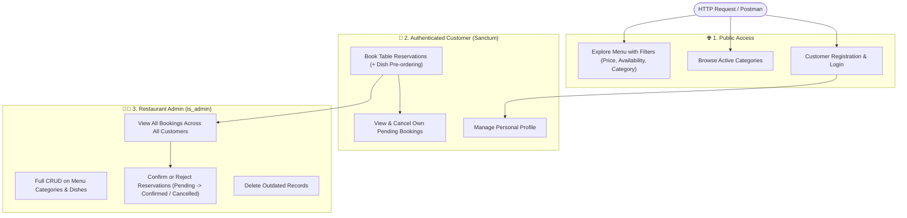
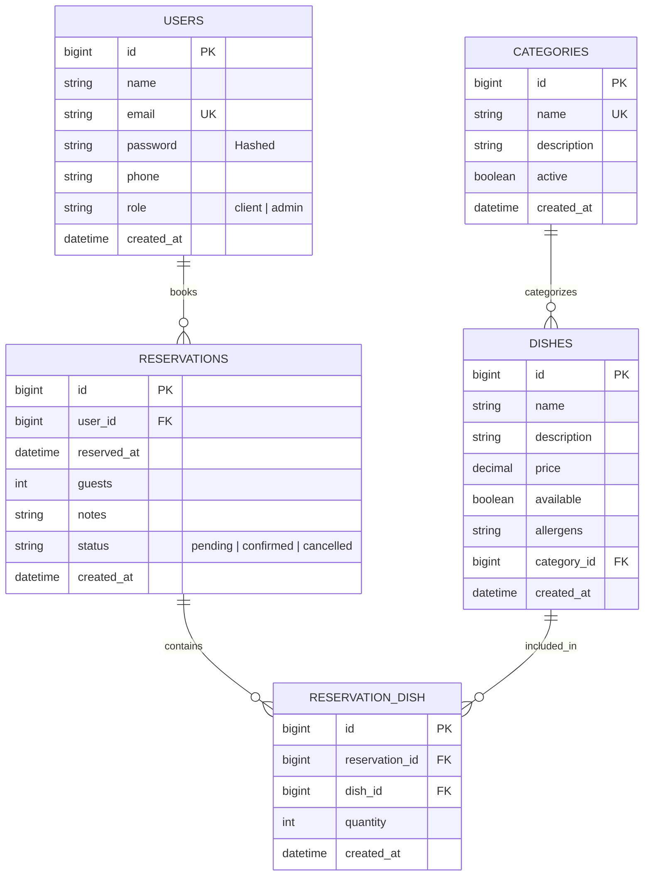
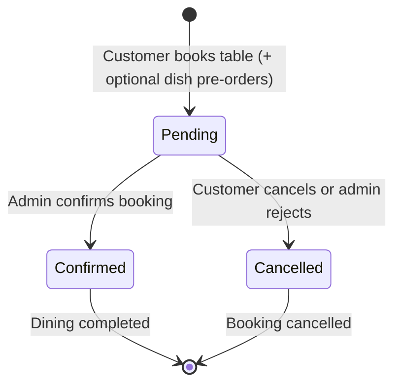

# 🍽️ Restaurant Management & Reservations API

<p align="center">
  
  
  
  
  
</p>

A RESTful restaurant menu and table reservation API built with **Laravel 11**, **Eloquent ORM**, and **Laravel Sanctum**.

It manages menu categories, dish items, customer table reservations with dish pre-ordering, and role-based permissions (Customer and Restaurant Admin).

---

## ⚡ Access Hierarchy



---

## 📊 Database Schema (ERD)



---

## 🔄 Reservation Status Lifecycle



---

## ✨ Features

* **Role-Based Access Control:** Custom `is_admin` middleware isolates administrative catalog and reservation controls from customer booking operations.
* **Table Bookings & Pre-Orders:** Customers can reserve tables and optionally pre-order specific dishes with quantities using the intermediate `reservation_dish` pivot table.
* **Status Workflow:** Reservations start in a `pending` state; admins can confirm or cancel bookings, while customers can cancel their own pending requests.
* **Menu Filters:** Built-in query filters for dishes (`?category_id=1&available=true&max_price=20.00`).
* **Validation & Feature Tests:** Validates future booking dates and guest counts; includes a feature test suite running on PHPUnit.

---

## 📑 API Endpoints Reference

### 👤 Authentication & Profile

| Method | Endpoint | Access | Description |
| :--- | :--- | :--- | :--- |
| `POST` | `/api/register` | Public | Customer account registration |
| `POST` | `/api/login` | Public | Authenticate and issue Sanctum token |
| `GET` | `/api/me` | 🔒 Authenticated | Retrieve authenticated user profile |
| `PUT` | `/api/me` | 🔒 Authenticated | Update user profile |
| `POST` | `/api/logout` | 🔒 Authenticated | Revoke access token |

### 🍽️ Menu & Categories

| Method | Endpoint | Access | Description |
| :--- | :--- | :--- | :--- |
| `GET` | `/api/categories` | Public | List active categories with dish counts |
| `GET` | `/api/categories/{id}` | Public | Category details with dishes |
| `POST` | `/api/categories` | 👨‍🍳 Admin Only | Create new category |
| `PUT` | `/api/categories/{id}` | 👨‍🍳 Admin Only | Update category |
| `DELETE` | `/api/categories/{id}` | 👨‍🍳 Admin Only | Delete category |
| `GET` | `/api/dishes` | Public | Query dishes (`?category_id=1&max_price=15`) |
| `GET` | `/api/dishes/{id}` | Public | Retrieve single dish details |
| `POST` | `/api/dishes` | 👨‍🍳 Admin Only | Add dish to menu |
| `PUT` | `/api/dishes/{id}` | 👨‍🍳 Admin Only | Update dish info |
| `DELETE` | `/api/dishes/{id}` | 👨‍🍳 Admin Only | Remove dish from menu |

### 📅 Reservations

| Method | Endpoint | Access | Description |
| :--- | :--- | :--- | :--- |
| `GET` | `/api/reservations` | 🔒 Authenticated | Customer sees own; Admin sees all |
| `GET` | `/api/reservations/{id}` | 🔒 Owner / Admin | View reservation details |
| `POST` | `/api/reservations` | 🔒 Customer | Book table with optional dishes |
| `PUT` | `/api/reservations/{id}` | 🔒 Owner (Pending) | Modify pending reservation |
| `PATCH` | `/api/reservations/{id}/cancel` | 🔒 Owner (Pending) | Cancel reservation |
| `PATCH` | `/api/reservations/{id}/status` | 👨‍🍳 Admin Only | Confirm or reject reservation |
| `DELETE` | `/api/reservations/{id}` | 👨‍🍳 Admin Only | Delete reservation record |

---

## 🔑 Pre-Configured Test Accounts (Seeders)

| Role | Email | Password | Privileges |
| :--- | :--- | :--- | :--- |
| **Admin** | `admin@restaurante.pt` | `password123` | Full access to menu CRUD, all reservations, and status transitions |
| **Customer** | `maria@email.com` | `password123` | Can book reservations, view personal history, and update profile |

---

## 🛠️ Getting Started

### Prerequisites
* **PHP 8.3+** with SQLite extension
* **Composer**

### 1. Clone the repository
```bash
git clone https://github.com/Afonsojlc/restaurant-api.git
cd restaurant-api
```

### 2. Install dependencies
```bash
composer install
```

### 3. Environment configuration
```bash
cp .env.example .env
php artisan key:generate
```
Ensure your `.env` contains:
```env
DB_CONNECTION=sqlite
```

### 4. Database initialization & seed
```bash
touch database/database.sqlite
php artisan migrate:fresh --seed
```

### 5. Run the application
```bash
php artisan serve
```
The API is available at `http://127.0.0.1:8000/api`.

---

## 🧪 Running Tests

To run the automated feature test suite:
```bash
php artisan test
```

---

## 📬 Testing with Postman

Postman collection and environment files are included:
* [`restaurant-api.postman_collection.json`](restaurant-api.postman_collection.json)
* [`restaurant-api.postman_environment.json`](restaurant-api.postman_environment.json)

1. Import both files into Postman.
2. Select the **Restaurant API** environment.
3. Run the **Login** request; the Bearer token will be automatically saved into the `{{token}}` variable.

---

## 📁 Project Structure

```text
restaurant-api/
├── app/
│   ├── Http/
│   │   ├── Controllers/          # Auth, Category, Dish, Reservation controllers
│   │   └── Middleware/           # IsAdmin role guard
│   └── Models/                   # User, Category, Dish, Reservation models
├── database/
│   ├── migrations/               # Schema migrations
│   └── seeders/                  # Seeders for demo data
├── routes/
│   └── api.php                   # API routes
├── tests/
│   └── Feature/
│       └── RestaurantApiTest.php # Feature tests
├── restaurant-api.postman_collection.json
├── restaurant-api.postman_environment.json
├── composer.json
└── README.md
```

---

## 👤 Author

**Afonso Carvalho**  
* GitHub: [@Afonsojlc](https://github.com/Afonsojlc)  
* LinkedIn: [Afonso Carvalho](https://www.linkedin.com/in/afonso-carvalho-64796328a/)

---

## 📄 License

This project is licensed under the [MIT License](LICENSE).
